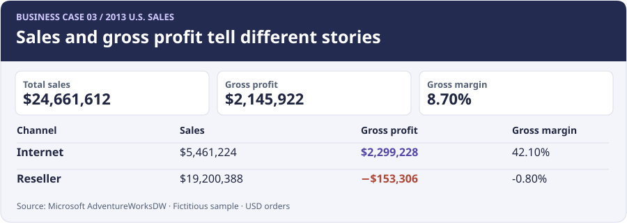

# AdventureWorks Sales Review: Where Did the Profit Come From?

## Introduction

I wanted to know whether the biggest sales channel was also the one making the most money. In the AdventureWorks sample, U.S. sales grew **17.11%** in 2013. Resellers brought in nearly **78%** of that year's sales, but their gross profit was negative. I compared the two channels to see what the sales total was hiding.

🔍 [SQL queries](sql/) · [Interactive dashboard](Sales_Dashboard.html) · [Query results](results/)

## Background

I used Microsoft's [AdventureWorksDW sample](https://github.com/microsoft/sql-server-samples/tree/master/samples/databases/adventure-works), which describes a fictitious bike and accessories company. I compared its **Internet** and **Reseller** channels for the two full calendar years **2012 and 2013**. I limited the analysis to U.S. territories and USD-keyed transactions so I could compare a consistent market without mixing currencies.

The two sales tables contain **121,253 lines** before filters. I combined them into one table, kept the channel on every row, and joined product, category, territory, and currency lookups. The final scope contained **50,784 lines**. One row is a line on an order, so I counted distinct order numbers inside each channel before adding the channel totals. I kept legitimate loss-making lines in the main totals.

### The Questions Answered:

1. How did sales and gross profit change, and which channel drove the change?
2. Which months led 2013 sales, and did high sales always mean high profit?
3. Which categories ranked highest by sales and gross profit?
4. What did discounted and full-price reseller lines contribute?
5. Did the sales increase still hold without the largest orders?

## Tools

- **SQL and SQLite:** I joined the sales and lookup tables, calculated KPIs, and compared years, categories, and price groups.
- **Python:** I loaded the original files, checked the keys and amounts, and exported the query results.
- **HTML and JavaScript:** I built a dashboard that switches between years and between sales and gross profit.
- **GitHub:** I shared the queries, outputs, and analysis.

## Analysis

I used **sales** for merchandise value after recorded discounts, before tax and freight. **Gross profit** is sales minus recorded product cost. **Gross margin** is total gross profit divided by total sales. It does not include operating expenses.

### Findings

#### 1. Online sales drove the growth, while reseller profit fell

| KPI | 2012 | 2013 |
|---|---:|---:|
| Sales | $21.06M | **$24.66M** |
| Gross profit | $1.24M | **$2.15M** |
| Gross margin | 5.87% | **8.70%** |
| Orders | 1,743 | **8,532** |
| Units | 55,538 | **75,027** |
| Average order value | $12,081.72 | **$2,890.48** |

I found that Internet sales grew by **$4.02M** and Internet gross profit grew by **$1.70M**. Reseller sales fell by **$421,000**, and reseller gross profit went from **$631,370** to **−$153,306**. The online channel earned **$2.30M** in gross profit in 2013, more than the combined total because of the reseller loss.

I kept each channel's average order value in the [scorecard query](sql/01_channel_scorecard.sql). The overall average fell as online orders made up a much larger share of the order count. Reseller orders are wholesale baskets, so I would compare order value inside each channel before treating a change in the combined average as a change in how customers shop.



*The dashboard shows why I kept the two metrics side by side: Reseller led sales at $19.20M, while Internet led gross profit at $2.30M. Download the [HTML dashboard](Sales_Dashboard.html) and open it in a browser to switch years and metrics.*

#### 2. The strongest sales month was not the strongest profit month

I found that **January** had the most sales in 2013 at **$2.60M**, about **$1,426** ahead of November. January made **$67,635** in gross profit, compared with **$276,835** in November. February also cleared **$2.55M** in sales but recorded a gross loss of **$21,687**.

I grouped the sales lines by month before using `LAG`. Because I checked that all 24 months exist, 12 rows back is the same month last year. The [monthly query](sql/02_monthly_trend.sql) shows that November sales were up **77.70%** year over year.

```sql
WITH monthly AS (
  SELECT month, SUM(revenue) AS sales, SUM(profit) AS profit
  FROM scoped
  GROUP BY month
)
SELECT month, sales, profit,
       LAG(sales, 12) OVER (ORDER BY month) AS last_year_sales
FROM monthly;
```

#### 3. Bikes led both rankings; Accessories moved up on profit

**Bikes** ranked first in 2013 for sales (**$20.68M**) and gross profit (**$1.64M**). **Accessories** ranked last of four categories by sales (**$420,785**) but second by gross profit (**$217,016**). Its gross margin was **51.57%**.

I built one row per category and year before ranking. I used `DENSE_RANK` twice because the category that ranks highest in sales can rank differently in profit. `PARTITION BY year` restarts the comparison each year, and ties share a rank without skipping the next one. [Category query](sql/03_category_rank.sql)

```sql
SELECT year, category,
       DENSE_RANK() OVER (PARTITION BY year ORDER BY sales DESC) AS sales_rank,
       DENSE_RANK() OVER (PARTITION BY year ORDER BY profit DESC) AS profit_rank
FROM category_totals;
```

#### 4. Discounted reseller lines recorded a gross loss

In 2013, discounted reseller lines made up **7.86%** of reseller sales and recorded **−$365,903** in gross profit. Full-price reseller lines made **$212,596**, at just **1.20%** margin. I used line values to assign the groups because one order can include items sold at both prices.

I calculated margin from summed profit and sales. Averaging the individual line margins would give a low-value item the same weight as a large line. The [discount query](sql/04_discount_review.sql) is a comparison of recorded groups; it does not isolate the effect of discounts from product mix, customer mix, or cost.

#### 5. The increase held when I excluded the largest orders

I used `ROW_NUMBER` to find the pooled 99th-percentile order value, **$72,337.83**. I applied the same cutoff to both years and kept orders tied at the cutoff. After excluding **65 orders in 2012** and **37 in 2013**, sales grew **40.87%**, versus **17.11%** in the full dataset. I kept large orders in the headline KPIs and used this [separate check](sql/05_order_sensitivity.sql) to see whether they changed the direction of the result.

### What I would look at next

I would start with reseller product lines that lost the most gross profit, then compare discounted and full-price sales for the same products. That would help me decide whether the next question is about pricing, product cost, or what resellers bought. I would also look at Accessories by channel before recommending a change in the sales mix.

The figures describe a Microsoft sample, and gross profit excludes operating expenses. See [data preparation and reproducibility](docs/DATA.md) for the source files, definitions, and checks.
